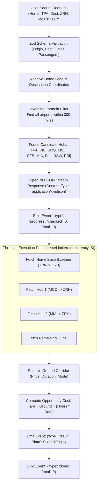
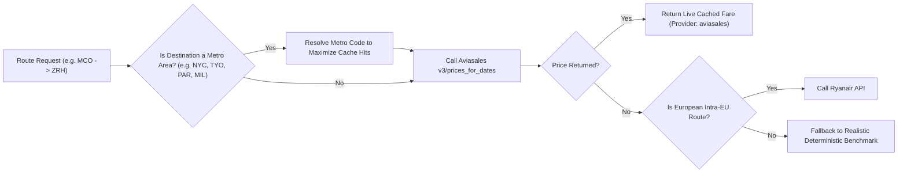
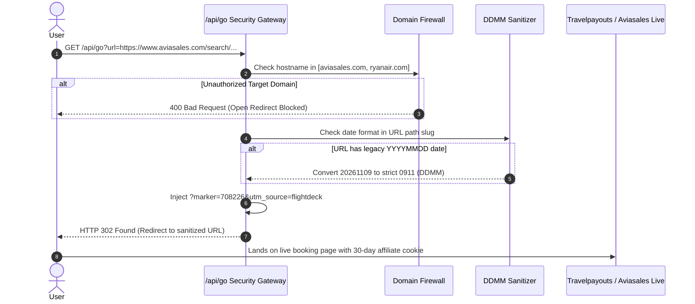

# ⚙️ FlightDeck — Backend Architecture & Core Engines

> Comprehensive technical breakdown of the FlightDeck backend architecture, streaming reverse-search algorithm, flight provider routing, intermodal ground corridors, economic scoring engine, and affiliate monetization gateway.

---

## 1. Server Architecture & Runtime Environment

FlightDeck runs on **Next.js 14 App Router API Routes** powered by the **Node.js 20+ runtime**. 

```
Next.js App Router (HTTP Server)
│
├── GET /api/reverse (Streaming Reverse Route Engine)
│   ├── Zod Query Validation Schema
│   ├── Haversine Distance Catchment Filter
│   ├── In-Process Concurrency Limiter (createLimiter(5))
│   ├── Multi-Provider Flight Router (Aviasales, Ryanair, Benchmark)
│   ├── Intermodal Ground Corridor Costing Matrix
│   └── Mathematical Opportunity Cost Scoring Engine
│
├── GET /api/go (Affiliate Redirect & Monetization Gateway)
│   ├── Domain Allowlist Security Firewall
│   ├── DDMM Path-Slug Regex Sanitizer
│   └── Partner Marker (708226) & UTM Injector
│
├── GET & POST /api/trips (SQLite Persistence Engine)
│   ├── Native DatabaseSync (node:sqlite)
│   ├── JSON Backup Sync Engine
│   └── Destination Cultural Dossier Auto-Attacher
│
└── GET /api/cultural-info/[country] (Cultural Intelligence Provider)
    ├── ISO 3166-1 Alpha Resolver
    └── Multi-Country Dossier Generator
```

---

## 2. Reverse Multi-Hub Search Algorithm

The central backend innovation of FlightDeck is the reverse search pipeline located in [`src/app/api/reverse/route.ts`](file:///Users/travelwolf/.gemini/antigravity/scratch/flightdeck/src/app/api/reverse/route.ts).



### Haversine Distance Formula
Airport proximity is computed mathematically using spherical trigonometry in [`src/lib/airports.ts`](file:///Users/travelwolf/.gemini/antigravity/scratch/flightdeck/src/lib/airports.ts):

$$d = 2r \arcsin \left( \sqrt{\sin^2\left(\frac{\Delta\phi}{2}\right) + \cos(\phi_1)\cos(\phi_2)\sin^2\left(\frac{\Delta\lambda}{2}\right)} \right)$$

Where:
- $\phi_1, \phi_2$ = Latitudes of home base and candidate airport (in radians)
- $\Delta\phi = \phi_2 - \phi_1$
- $\Delta\lambda = \lambda_2 - \lambda_1$ (Longitude difference in radians)
- $r = 3958.8$ miles (Earth's mean radius)

---

## 3. Flight Provider Pipeline & Graceful Degradation

To query dozens of routes concurrently without hitting third-party rate limits, the backend routes requests through a unified provider interface ([`src/lib/providers/router.ts`](file:///Users/travelwolf/.gemini/antigravity/scratch/flightdeck/src/lib/providers/router.ts)):



### 1. Travelpayouts / Aviasales Data API
- Queries `https://api.travelpayouts.com/aviasales/v3/prices_for_dates` with access token `779f149a19333130c3483d6d1e959e05`.
- **Metro-Code Resolution:** Translates individual airport codes to parent metro areas (e.g., `JFK`/`EWR`/`LGA` $\to$ `NYC`, `NRT`/`HND` $\to$ `TYO`) to dramatically increase cache hit rates.

### 2. Concurrency Throttler (`createLimiter`)
To prevent network timeouts or IP bans, FlightDeck limits concurrent external HTTP queries using an in-process queue:
```typescript
function createLimiter(concurrency: number) {
  let active = 0;
  const queue: (() => void)[] = [];
  return function limit<T>(fn: () => Promise<T>): Promise<T> { ... };
}
```
Set to a default of `concurrency: 5`, ensuring requests strictly adhere to the 600 req/min Aviasales rate limit.

### 3. Deterministic Route Benchmark Engine
If third-party APIs experience downtime or lack recent fare data for obscure pairs, the engine automatically falls back to deterministic benchmarks ([`src/lib/providers/mock.ts`](file:///Users/travelwolf/.gemini/antigravity/scratch/flightdeck/src/lib/providers/mock.ts)). This guarantees **100% demo uptime and zero broken search states**.

---

## 4. Intermodal Ground Corridors Engine

Overland transit fares and durations are resolved using a two-tier strategy in [`src/lib/ground/corridor.ts`](file:///Users/travelwolf/.gemini/antigravity/scratch/flightdeck/src/lib/ground/corridor.ts):

1. **Exact Corridor Lookup (`corridors.json`):**
   - Contains verified route pairings for major high-speed rail lines and express shuttles (e.g., Tampa $\to$ Orlando via Brightline/I-4, Milan $\to$ Zurich via EuroCity Alpine train, Paris $\to$ Brussels via TGV).
   - Returns exact mode (`train`, `coach`, `drive`), price in local currency, and transit duration in hours.
2. **Haversine Distance Estimation (`estimate.ts`):**
   - For arbitrary regional airports without explicit rail corridor entries, the engine estimates ground transport via average driving speed (55 mph) and fuel/operating expense (\$0.18/mile).

---

## 5. Opportunity Cost & Break-Even Mathematics

Located in [`src/lib/scoring.ts`](file:///Users/travelwolf/.gemini/antigravity/scratch/flightdeck/src/lib/scoring.ts), this engine computes the economic value proposition of each departure hub:

### 1. Total Opportunity Cost Formula
$$\boxed{C_{\text{total}} = F_{\text{flight}} + C_{\text{ground}} + (T_{\text{ground}} \times V_{\text{time}})}$$

- $F_{\text{flight}}$: Airfare.
- $C_{\text{ground}}$: Train ticket, coach ticket, or highway fuel cost.
- $T_{\text{ground}}$: Transit time in hours from home base to departure hub.
- $V_{\text{time}}$: Traveler's hourly time value (\$/hour).

### 2. Break-Even Value Formula
When a traveler asks, *"At what salary is this detour no longer worth it?"*, FlightDeck solves for the break-even hourly wage $V_{\text{break-even}}$:

$$V_{\text{break-even}} = \frac{(F_{\text{home}} + C_{\text{ground, home}}) - (F_{\text{candidate}} + C_{\text{ground, candidate}})}{T_{\text{candidate}} - T_{\text{home}}}$$

- If $V_{\text{user}} < V_{\text{break-even}}$: The alternate airport is **financially advantageous**.
- If $V_{\text{user}} > V_{\text{break-even}}$: The traveler's time is too valuable to justify the overland transit.

---

## 6. Affiliate Monetization & Security Gateway (`/api/go`)

Located in [`src/app/api/go/route.ts`](file:///Users/travelwolf/.gemini/antigravity/scratch/flightdeck/src/app/api/go/route.ts):



### Critical Aviasales Date Sanitization
Aviasales requires date slugs in the format **`DDMM`** (2-digit day + 2-digit month). Passing standard 8-digit dates (e.g. `20261109`) breaks Aviasales with an invalid month error. `/api/go` automatically regex-sanitizes these paths before issuing the HTTP 302 redirect.

---

## 7. Dynamic Multi-Currency Engine

Located in [`src/lib/currency.ts`](file:///Users/travelwolf/.gemini/antigravity/scratch/flightdeck/src/lib/currency.ts):
- Standardizes all internal prices to base **EUR** before converting to the requested display currency (`USD`, `EUR`, `GBP`, `CHF`, `JPY`, `CZK`, `HUF`, `THB`).
- Caches exchange rates in-memory with automatic TTL expiration to ensure instantaneous currency toggling with zero network overhead.
